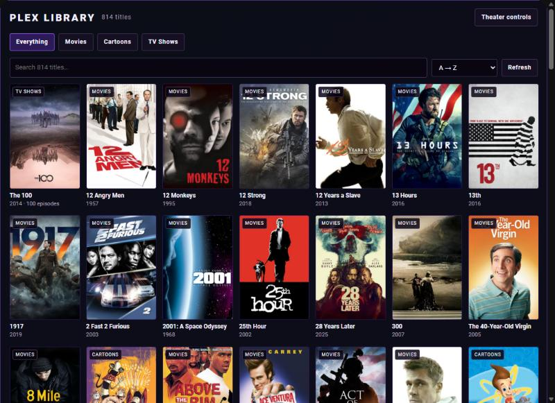
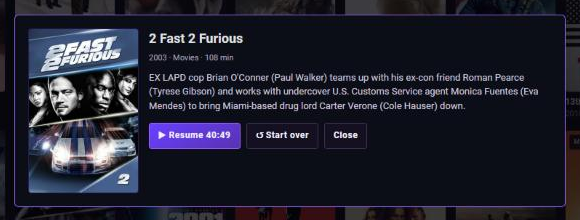
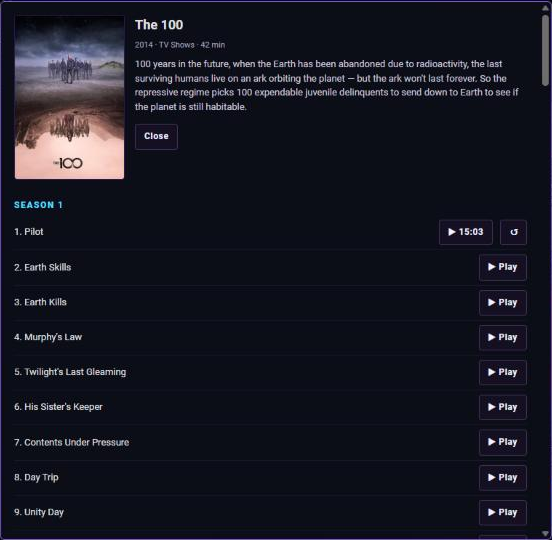
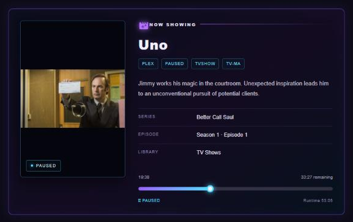

# Plex Direct Play & Scrub for Home Assistant (Android TV / NVIDIA SHIELD)

Browse your whole Plex library as posters on a Home Assistant dashboard, tap a movie or episode,
and it **starts playing on your TV**: no searching, no remote. Choose **Resume** or
**Start over**. While it plays, **drag the progress bar** on the dashboard to jump anywhere in
the movie **without leaving it**.



| Resume or Start over | Episodes of a show | Scrub without leaving the movie |
|---|---|---|
|  |  |  |

Tested with the **Plex for Android TV** app (2026.x, the new React Native app) on an
**NVIDIA SHIELD (Android 11)**. It should work on other Android TV devices running the same Plex app.

| Feature | What you get |
|---|---|
| **Plex library on your dashboard** | Every movie, show and cartoon from your Plex server as a poster grid, with search, filters and sorting |
| **Direct play** | Tap a title, then Play, and the TV opens it in Plex and starts it in about 5–15 seconds, with no restart of the Plex app |
| **Resume / Start over** | Partly watched titles offer "Resume 41:12" or "Start over"; works for movies **and** TV episodes |
| **In-movie scrub** | Drag the Now Playing bar and the movie jumps there instantly and keeps playing, exact to the second |

> Not affiliated with Plex Inc. or NVIDIA. It uses only your own devices on your own network.

---

## How it works (short version)

* **Library card.** It reads your library directly from your Plex Media Server, the same way Plex's own apps do.
* **Direct play.** The Plex app accepts an internal library link,
  `plex://libraries/<serverId>/movie/<slug>/<key>` (episodes:
  `…/show/<slug>/<showKey>/s/<season>/<seasonKey>/e/<episode>/<episodeKey>`), that opens the title's
  page *inside the running app*. A small script on the TV then taps Plex's own
  `Watch/Resume` or `Restart` button.
* **Scrub.** Plex's player exposes Android's standard media-session "seek to". A tiny helper
  (`seek.dex`, source included) calls it, so the movie never stops or reloads.
* **Home Assistant** runs all of it on the TV through the built-in **Android TV (ADB)** integration.

---

## What you need

* **Home Assistant** (2024.6 or newer).
* **Plex Media Server** with your library.
* **Android TV / NVIDIA SHIELD** with the **Plex** app, on the same network.
* A computer with **adb** ([Android platform-tools](https://developer.android.com/tools/releases/platform-tools)), for a one-time file copy to the TV.

---

## Step 1: Add Plex to Home Assistant

This gives Home Assistant a player entity for your TV's Plex app (used by the Now Playing card).

1. In Home Assistant go to **Settings → Devices & services → Add integration**.
2. Search for **Plex Media Server** and sign in with your Plex account. Pick your server.
3. Play anything in Plex on the TV once. A player entity appears, for example
   `media_player.plex_plex_for_android_tv_shield_android_tv`. Note its name for Step 6.

## Step 2: Show your Plex library with posters (Plex Library card)

1. Install the cards. Both come in one file.

   **Option A: HACS (easiest)**
   1. Open **HACS**, then **⋮** (top right), then **Custom repositories**.
   2. Repository: `https://github.com/Zaywest/ha-plex-shield-control`. Type: **Dashboard**. Select **Add**.
   3. Search HACS for **Plex Direct Play & Scrub**, open it, and select **Download**.
   4. Reload the browser page when HACS asks. HACS adds the dashboard resource for you.

   HACS installs only the two cards. The scripts (Step 5) and the TV helper files (Step 4)
   still need to be set up by hand.

   **Option B: manual**
   1. Copy [`dist/ha-plex-shield-control.js`](dist/ha-plex-shield-control.js) to
      `/config/www/ha-plex-shield-control.js`, using the **File editor** or **Studio Code
      Server** add-on, or Samba.
   2. **Settings → Dashboards → ⋮ → Resources → Add resource** (turn on *Advanced mode* in your
      profile if you don't see Resources): URL `/local/ha-plex-shield-control.js`, type
      **JavaScript module**.
2. Add a dashboard view with the card. A **panel** view gives it the full width:
   ```yaml
   type: custom:plex-library-card
   ```
   (Full example: [`homeassistant/dashboard-example.yaml`](homeassistant/dashboard-example.yaml).)
3. Open the view and tap **Link this device**. On your phone or computer go to
   **https://plex.tv/link** and enter the 4-letter code. The card connects by itself and shows
   your whole library: posters, search, filters (Everything / Movies / TV Shows / …), sorting,
   and infinite scroll (as in the screenshot at the top of this page).
   * Each browser or tablet links once. The Plex server address and token are saved **only in
     that browser** (localStorage), never in Home Assistant.
   * Tap a show to see its seasons and episodes.

At this point you can browse. The Play buttons need Steps 3–5.

## Step 3: Let Home Assistant control the TV (network debugging)

On the **SHIELD / Android TV**:

1. **Settings → Device Preferences → About**, then select **Build** 7 times, until it says you're a developer.
2. **Settings → Device Preferences → Developer options → Network debugging → On**.
   Note the TV's IP address (Settings → Network).

In **Home Assistant**:

3. **Settings → Devices & services → Add integration → Android TV** (the ADB one, *not*
   "Android TV Remote"). Enter the TV's IP and keep the default port 5555.
4. A prompt **"Allow network debugging?"** appears on the TV. Tick **Always allow from this
   computer** and select **Allow**. (If you miss it, turn Network debugging off and on, then
   reload the integration.)
5. Note the new entity, for example `media_player.android_tv_192_168_1_50`.

## Step 4: Copy the two helper files to the TV (one time)

From a computer with adb, in this repository's folder:

```bash
adb connect 192.168.1.50:5555          # your TV's IP; accept the prompt on the TV
adb push shield/plexplay.sh /data/local/tmp/plexplay.sh
adb push shield/seek-helper/seek.dex /data/local/tmp/seek.dex
adb shell chmod 755 /data/local/tmp/plexplay.sh
```

The files survive reboots and Plex app updates. `seek.dex` is built from
[`shield/seek-helper/Seek.java`](shield/seek-helper/Seek.java). Rebuild it yourself with
[`build.sh`](shield/seek-helper/build.sh) if you prefer not to use the prebuilt file.

## Step 5: Add the Home Assistant scripts

1. Copy both scripts from [`homeassistant/scripts.yaml`](homeassistant/scripts.yaml) into
   your `scripts.yaml`, or create each one in **Settings → Automations & scenes → Scripts →
   Add script → ⋮ → Edit in YAML**.
2. In **both** scripts change `tv: media_player.android_tv` to your Android TV (ADB)
   entity from Step 3.
3. Reload scripts (**Developer tools → YAML → Scripts**). You now have:
   * `script.plex_library_play` (used by the Plex Library card's Play buttons)
   * `script.plex_seek` (used by the Now Playing card's scrub bar)
4. Optional: if your TV, projector or receiver needs turning on first, add your own script
   call at the marked spot near the top of `plex_library_play`.

## Using it: direct play, Resume, Start over

On the **Plex Library** view, tap a poster:

* **Movie you haven't started:** **▶ Play on SHIELD**.
* **Partly watched movie:** **▶ Resume 41:12** or **↺ Start over**.
* **Show or cartoon:** opens the episode list; each episode has **▶ Play**, or **▶ 12:34**
  and **↺** if it's partly watched.

<p>
  <br>
  
</p>

What happens on the TV:

1. Plex opens the title's page *inside the already-running app*, so there's no logo screen. If
   Plex wasn't running at all, it starts first, and that one start shows the logo.
2. The script taps **Watch / Resume**, or **Restart** for Start over, and checks that playback
   actually began. If something is in the way it retries; if it can't start, you get a Home
   Assistant notification.

Anything already playing is stopped first, so switching titles works.

## Step 6: Scrubbing with the Now Playing card

Add the Now Playing card (example in `dashboard-example.yaml`):

```yaml
type: custom:plex-now-playing-card
plex: media_player.plex_your_tv      # the Plex player entity from Step 1
```

It shows the artwork, title, synopsis and a progress bar. **Drag or tap the bar** (or focus it
and use ←/→ then Enter). A bubble shows the target time, and on release the movie jumps there
and **keeps playing**: no stop, no reload, accurate to about a second. It works for movies,
TV episodes and cartoons.


Optional card settings: `shield` (Android TV Remote entity), `receiver` (AV receiver, shows
audio/video formats), `seek_script`.

---

## Troubleshooting

| Problem | Fix |
|---|---|
| **Play does nothing / notification "No library link was sent"** | The dashboard on that device is running an old cached card. Refresh it (in the Companion app: Settings → Companion app → Debugging → Reset frontend cache). |
| **Notification "Could not start …"** | Check that the Android TV (ADB) entity is available and Network debugging is still on. Test: Developer tools → Actions → `androidtv.adb_command` with `sh /data/local/tmp/plexplay.sh pos`. |
| **Scrub doesn't move** | Make sure `/data/local/tmp/seek.dex` is on the TV (Step 4). Without it the script falls back to fast-forward/rewind steps, which are slow for long jumps. |
| **Plex logo appears when pressing Play** | Plex wasn't running yet; only the first title after the TV wakes shows it. |
| **A Plex app update broke it** | Plex may have renamed its buttons (`action-button-watch`, `action-button-watchFromStart`). The script falls back to pressing the selected button. Open an issue. |

## Security notes

* **Network debugging** lets any computer you approve control the TV. Only approve your Home
  Assistant and your own computer, and keep the TV on a trusted network.
* The Plex token used by the library card stays in each browser's local storage.
* All code that runs on the TV is in this repo (`plexplay.sh`, `Seek.java`).

## Files

```
dist/ha-plex-shield-control.js     both cards in one file (what HACS installs)
hacs.json                          HACS settings
build-dist.sh                      rebuilds dist/ from cards/
cards/plex-library-card.js         Plex Library dashboard card (posters, Play / Resume / Start over)
cards/plex-now-playing-card.js     Now Playing card with the scrub bar
homeassistant/scripts.yaml         script.plex_library_play + script.plex_seek
homeassistant/dashboard-example.yaml
shield/plexplay.sh                 runs on the TV: open / play / seekto / pos
shield/seek-helper/Seek.java       media-session seek helper (source)
shield/seek-helper/seek.dex        prebuilt helper
shield/seek-helper/build.sh        rebuild seek.dex (JDK + Google's d8)
docs/how-it-works.md               the details: links, button ids, seek
docs/images/                       screenshots
```

## License

MIT. See [LICENSE](LICENSE).
